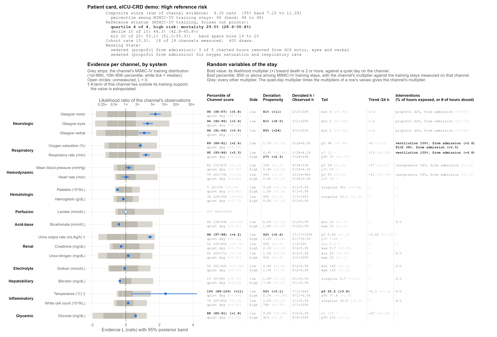

# A Composite ICU Mortality Score from Weights of Evidence

This repository holds the code for the preprint *A Composite ICU Mortality Score from Weights of Evidence of First-Day
Measurements and Interventions Estimated with Channel-Wise Additive Models* (medRxiv, link to follow). The score is built from the
first 24 hours of an ICU stay. We developed it on MIMIC-IV, and we validated it, frozen, on 207 hospitals of the eICU Collaborative
Research Database.

## What the method does

Each of nineteen measurements is modeled together with the interventions that act on it, and we call the pair a channel. For each
channel, a generalized additive model estimates a weight of evidence for in-hospital mortality, which states in which direction, and
how strongly, the channel points. The composite score is derived from the channel weights of evidence, and risk is reported as the
observed mortality of the reference-population stratum into which the score of a stay falls.

## Design philosophy

We designed the score so that each of its parts carries a meaning that we chose before estimating it. Section 2 of the paper gives the
argument for each principle.

1. **The weight of evidence is the unit of the score.** Its sign states toward which outcome an aspect of the record points, and its
   magnitude states how far. Weights of evidence from different sources share this unit, so the subscores of the composite score can
   be compared with each other and added.
2. **Measurements are modeled with their interventions.** We view a measurement as an indicator of the health of a physiological
   system and its interventions as the controls applied to bring it back into range. A blood pressure within range may be the pressure
   of a stable patient, or the pressure of a patient held in range by a vasopressor.
3. **The random variables can be described in words.** For each measurement we track how often it left its reference range, how far
   its tail went on the side that its control acts on, and how it trended, and for each intervention the fraction of hours exposed
   and the intensity given that exposure. We apply this construction to each of the nineteen channels, so a fitted function has the
   same reading in every channel.
4. **Each measurement gives one weight of evidence.** The composite score has as many components as there are chosen measurements,
   and the components have a fixed meaning rather than one assigned by an algorithmic allocation of a prediction.
5. **The random variables are estimated as parameters with likelihood models.** A deviation propensity is the same kind of quantity
   for every measurement, so the propensity of creatinine can be placed beside that of mean blood pressure, while their raw deviation
   counts cannot. The likelihood models also account for differences in charting within and between sites.
6. **A channel that was not measured contributes nothing.** It receives a weight of evidence of zero, so missing data are neither
   imputed nor modeled.
7. **Risk is reported against a reference population,** as the observed mortality of a frozen stratum of the score.

## Reading one patient

The patient card presents one stay through the frozen models: the composite score with its band and reference stratum, each
channel's weight of evidence with its uncertainty, and the random variables of the stay. The card below is a high-risk stay from the
openly licensed eICU-CRD demo (Open Database License). A dagger marks a channel with a term outside the support of the training data,
here urine output rate and temperature. The evidence of those channels rests on extrapolation of the fitted functions, and temperature
carries a wide band.



## Data access and use of large language models

MIMIC-IV version 3.1 and eICU-CRD version 2.0 are available through PhysioNet to credentialed users who sign their data use
agreements, and no data are included in this repository. The patient cards use the eICU-CRD demo, which is released under the Open
Database License.

The code was developed with Claude Code. No patient-level or stay-level data entered any model context: the models wrote scripts that
ran locally, and only aggregate output, such as counts and summaries, returned to them. A permission guard blocked row-level access and
network transfer of the data at the tool boundary. The declarations of the paper give the full statement.

## Repository layout

The pipeline is implemented in R as a graph of targets, and the application to the test set and to eICU is carried out by runners that
read a frozen bundle of parameters and fit nothing. The analyses beyond the pipeline are scripts under `tests/`, each of which writes its
own run folder, and `run/reproduce.R` runs the whole analysis in the order of the paper.

| Path | Contents |
|---|---|
| `sql/mimiciv/`, `sql/eicu/` | BigQuery extraction, one file per stage |
| `sql/eicu_demo/` | the eICU extraction retargeted to the open demo, generated by `make_demo_sql.py` |
| `R/` | the pipeline: loading, random variables, formulas, evidence models, metrics, comparators, bundle, attribution |
| `_targets.R` | the target graph of the pipeline |
| `run/` | runners: `internal.R` (training), `test_look.R` (MIMIC-IV test set), `external.R` (eICU), `patient_card.R`, and `reproduce.R`, which runs the steps of the paper |
| `config/` | the fitted design (`config.yml`), runner settings, the measurement–intervention pairing, and the steps of the paper (`reproduce.yml`) |
| `tests/` | checks, model diagnostics, the comparator and heterogeneity analyses, and the attribution generators and their metrics |
| `python/` | the explainable boosting machine comparator (`ebm_fit.py`) and its pinned requirements |
| `paper/` | the scripts that draw the figures and tables (`make_*.R`), which write to `paper/figs/` and `paper/tables/` |

## Requirements

- Google BigQuery with PhysioNet credentialed access to MIMIC-IV 3.1 and eICU-CRD 2.0.
- R 4.5 with targets, mgcv, xgboost, arrow, yaml, qs2, digest, Matrix, ggplot2, ggtext, patchwork, scales, ragg and ggrepel. We used
  R 4.5.2, mgcv 1.9-4, xgboost 3.1.2 and targets 1.12.0. There is no lockfile.
- Python 3 with a virtual environment at `.venv-ebm/`, built from `python/requirements-ebm.txt`, for the explainable boosting machine.
  We used Python 3.13.1 and interpret-core 0.7.8. The demo SQL generator needs only the standard library.
- A second copy of R 4.5.2 whose BLAS and LAPACK are OpenBLAS 0.3.28, at `out/cache/tools/R-4.5.2-openblas/`, for the joint GAM
  comparator. We made it by copying the R installation and replacing `bin/x64/Rblas.dll` and `bin/x64/Rlapack.dll` with the OpenBLAS
  DLL from its official GitHub release. Our runs use two threads (`OPENBLAS_NUM_THREADS=2`), and runs at one and at two threads differ
  by up to 1.2e-4 in the predicted probability. The joint arms of `tests/stab_ladder_gen.R` stop on any other R, and the generator
  records the checksums of the two DLLs in the identity of its store.

The interpreters are declared at the top of `config/reproduce.yml`. Off Windows, point `python` to `.venv-ebm/bin/python` and
`openblas` to an R linked to OpenBLAS.

## Reproducing the paper

### 1. Extraction in BigQuery

The SQL runs in BigQuery, one file at a time, in the order below, since each stage reads tables written by the stages before it. The
queries read the PhysioNet datasets and write to our own project names, `mimic-iv-ext-icumort-1.mimiciv_ext_icumort_1` and
`eicu-ext.eicu_ext_data`, which you need to replace with your own project and dataset.

MIMIC-IV (`sql/mimiciv/`):
1. `v2_01_cohort_mimiciv.sql`
2. `v2_02a_agents_mimiciv.sql`
3. `v2_03a_signals_hourly_raw.sql`
4. `v2_02b_interventions_mimiciv.sql`
5. `v2_03b_signals_hourly_binned.sql`
6. `v2_04_hourly_gcs_mimiciv.sql`
7. `v2_05_features_mimiciv_rev3.sql`
8. `v2_06_severity_mimiciv.sql`

eICU (`sql/eicu/`):
1. `v2_01_cohort_eicu.sql`
2. `v2_01b_cohort_attrition_eicu.sql`
3. `v2_02a_agents_eicu.sql`
4. `v2_03a_signals_hourly_raw_eicu.sql`
5. `v2_02b_interventions_eicu.sql`
6. `v2_03b_signals_hourly_binned_eicu.sql`
7. `v2_04_hourly_gcs_eicu.sql`
8. `v2_05_features_eicu.sql`
9. `v2_06_severity_eicu.sql`

The demo files in `sql/eicu_demo/` run in the same order against `physionet-data.eicu_crd_demo`. They are generated from the eICU
files by `python sql/eicu_demo/make_demo_sql.py`, which changes only the source dataset and adds the suffix `_demo` to each table it
writes.

### 2. Export to parquet

Download each final table and save it as parquet, with the file names that `config/config.yml`, `config/external.yml` and
`config/external_demo.yml` expect:
- `data/mimiciv/`: `v2_cohort_mimiciv`, `v2_features_signals_mimiciv`, `v2_intervention_features_mimiciv`, `v2_severity_mimiciv`;
- `data/eicu/`: `v2_cohort_eicu`, `v2_features_signals_eicu`, `v2_intervention_features_eicu`, `v2_severity_eicu`,
  `v2_cohort_hospital_eicu`;
- `demo/eicu_demo/`: `v2_cohort_eicu_demo`, `v2_features_signals_eicu_demo`, `v2_intervention_features_eicu_demo`,
  `v2_cohort_hospital_eicu_demo`.

We did this step by hand. A table downloaded as CSV converts with the arrow package:

```r
arrow::write_parquet(arrow::read_csv_arrow("v2_cohort_mimiciv.csv"), "data/mimiciv/v2_cohort_mimiciv.parquet")
```

The `ordering` entry in `config/config.yml` points to an optional audit table that the current extraction does not write, and you can
remove that line.

### 3. Running the analysis

From here on, `run/reproduce.R` runs the analysis from the project root. It reads the steps of the paper from `config/reproduce.yml`
and runs them in order. Each step calls a runner or a script, and each run writes a new time-stamped folder,
`out/runs/<prefix>_<YYYYmmddTHHMMSS>/`. The driver hands each step the folders of the steps it reads, so no path needs to be edited by
hand. To list the steps, to see what would run, and to run everything not yet done:

```bash
Rscript run/reproduce.R --list
```

```bash
Rscript run/reproduce.R --dry-run
```

```bash
Rscript run/reproduce.R
```

The steps fall into six tiers: checks; core, which holds training, the test set, eICU, the model diagnostics and the patient cards;
comparators, which holds the explainable boosting machine and the joint GAM; heterogeneity; reproducibility, which holds the attribution
and stability analyses; and figures. `--tier core` runs one tier, and `--from` and `--to` run a range of steps. The checks read the
MIMIC-IV tables, so they run after the export.

The driver stops at the first failure and prints the last lines of the log of that step. The full logs are in `out/reproduce/logs/`,
and the state of the chain is in `out/reproduce/state.yml`, so running the driver again resumes where it stopped. `--redo <step>` runs a
step again, and `--bind <step>=out/runs/<folder>` records a run made outside the driver as the result of that step.

The runners read the bundle and a few run folders from `config/internal.yml`, `config/external.yml`, `config/external_demo.yml` and
`config/gam_qc.yml`. The driver sets those entries as the steps finish and prints each change, and `--restore-configs` puts the files
back as they were.

The `test` step scores the held-out MIMIC-IV test set with the frozen bundle. In a reproduction it recomputes results already published,
so it informs no design choice.

The longest steps took the following times on our machine, a Windows laptop with R 4.5.2. The other steps took minutes each, apart from
the explainable boosting machine fits, the joint GAM fits and the stability ladder (`stabgen`), which we did not time.

| Step | What it does | Time |
|---|---|---|
| `internal` | builds the target graph on MIMIC-IV and exports the frozen bundle | about 1 hour |
| `concurvity_null` | calibrates the concurvity diagnostic of the evidence models against a permutation null | 3.8 hours |
| `attrgen` | refits the attribution methods on 38 resampled subsets of the training data | 5.1 hours |
| `attr_metrics` | the reproducibility metrics at MIMIC-IV | 56 minutes |
| `attrextgen` | the same refits, applied to the eICU cohort | 2.1 hours |
| `attr_metrics_eicu` | the reproducibility metrics at eICU | 44 minutes |
| `external` | applies the frozen bundle at eICU | 22 minutes |
| `gam_qc` | quality checks of the evidence models | 22 minutes |
| `smoke` | checks before fitting | 8 minutes |

The generator `attrgen` can resume after an interruption, but the driver would start it afresh. To resume it, run it by hand on its
folder, and then bind the folder, which also continues the chain:

```bash
Rscript tests/attr_replicates.R --resume out/runs/attrgen_<time>
```

```bash
Rscript run/reproduce.R --bind attrgen=out/runs/attrgen_<time>
```

### Runs of record

Each step of `config/reproduce.yml` names the runs of ours that the paper cites (`cited`); those runs are not in this repository. The
paper cites two generations of the training, test-set and eICU runs, of September and of October 2026, which differ only in the
severity cut points. The current code gives the cut points of October.

## License

The code is released under the MIT License (`LICENSE`). The data are governed by the PhysioNet data use agreements.

## Citation

The preprint citation will follow.
